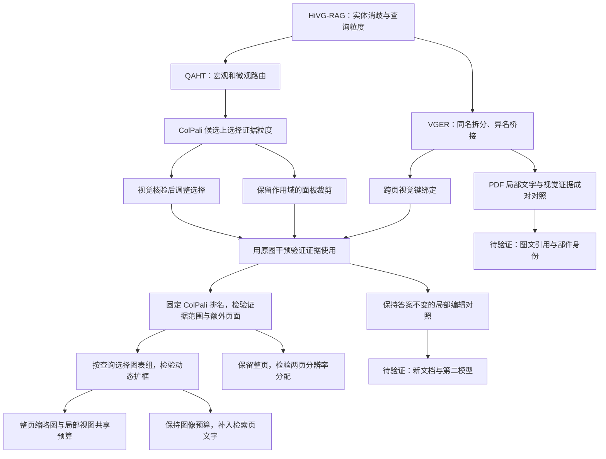

# ICME 研究路径图

2026-11-24。目标是解释多模态文档问答中，粒度选择何时影响模型能否依据正确对象答题。沿用冻结模型、原始 PDF、可复查的来源框和已跑通的 ColPali 底座。

| 路线 | 假设和实测 | 决策、重开条件和可复用资产 |
| --- | --- | --- |
| VGER 同名拆分 | 冻结裁剪相似度能阻止错误合并。新文档的 11 对同名异物中，几何增强后仅 1 对自动命中两端，仍合并。人工框下默认阈值合并 11/11。 | 结束固定余弦阈值路线。若新方法能在独立文档上自动定位两个端点并辨别作用域，重开。复用身份对、框和定向题。 [复验](../../experiments/vger-pilot/split-holdout-report.md) |
| VGER 异名桥接 | 图像相似可跨区域找回别名。受控图上的跨区域留出召回为 1/9，别名窗口从 1 页放宽到 8 页仍为 1/9。 | 暂停外观相似度桥接。重开需有显式引用、编号或其他来源证据，以及独立别名样本。 [图级结果](../../experiments/vger-pilot/report.md) |
| 自动定位 | MinerU、名称提取、Grounding DINO、PDF 坐标可定位实体。生产同时认对名字和框的只有 2/101，PDF 几何前五框命中 15/101 且集中于一份文档。已有自动图表块能覆盖 15/15 道旧定位题的目标框。 | 保留图表级定位作为起点。实体级定位作为单独的评测变量。 [原定位结果](../../experiments/vger-pilot/report.md) · [图表块覆盖](kg-mechanism-transfer.md) |
| QAHT 宏微路由 | 词法与熵可决定检索粒度。默认、仅熵和全图 Micro 的完整证据页覆盖分别为 14/50、17/50、19/50。 | 结束固定二选一路由。复用固定预算回放、逐题证据覆盖和图结构。 [路由重放](../../../runs/vger-pilot/routing-entropy/results.json) |
| 跨页证据覆盖 | 19 道跨页开发题，VisRAG 和 ColPali 的前两页各完整命中 9 道，前六页分别命中 15 道和 14 道。合并两份候选池覆盖 16 道，与任一方法单独命中的题集并集相同。 | 保留用于诊断候选召回与上下文预算的差距。跨页重排仍是待验证方案。 [页面排名回放](next-research-direction.md#动机和已观测证据) |
| 跨页视觉键绑定 | 显式传递年份、系列等中间键能减少取错值。人工裁剪下原题两组均为 5/5，整页均为 3/5，替换键时显式 5/5、自由文本 3/5。 | 暂停作为独立准确率贡献。保留中间键及替换对照，供读图错误诊断。 [绑定记录](../../experiments/visual-binding-pilot/report.md) |
| ColPali 上的预算内选页与裁剪 | 跨页直接改排名减少证据覆盖。固定前两页后，静态分歧规则的开发 ANLS 从 0.226 到 0.253，留出从 0.2644 到 0.2650。 | 保留 ColPali 排名、生成器、预算记录与裁剪对照。静态分歧打分缺少迁移证据。 [ColPali 复测](../../experiments/colpali-granularity/report.md) |
| 保留面板标题 | 图表框有时丢掉决定对象的标题。修复后，目标可见且无同名干扰由 6/14 到 12/14，答对 2/4 到 4/4。对同一裁剪候选，两种规则选择相同。 | 保留为强基线。若据此提出方法，需证明相同视图下有额外的稳定收益。 [同名面板定向题](../../experiments/colpali-granularity/report.md#同名面板定向题) |
| 视觉核验后调整视图 | 缩略图核验可以改变候选选区。留出净增益来自同一 PDF 的一道题，定向数值题由 4/4 降至 3/4。五次替换的自报线索均无法通过 PDF 文本字段的事后区分检验。 | 暂停无约束的模型自报核验。重开需用能独立核对的身份线索，并同预算超过强静态基线。 [试验与回放](../../experiments/colpali-granularity/report.md#留出文档与视觉核验) |

## 当前优先验证：图文引用与实体身份

按项目指令，下一轮先回答 VGER 能否同时减少同名误合并及找回异名同物。图表证据使用评测保留为独立分支。 [项目研究问题](../../../AGENTS.md)

| 路线 | 假设和实测 | 决策、重开条件和可复用资产 |
| --- | --- | --- |
| 局部文字加视觉相似度 | 41 个旧留出配对中，纯文本、加整图、加局部裁剪均误合并 1/4。同名同物保留为 4/7、3/7、7/7。别名精确率为 9/24、8/13、9/20，召回为 9/9、8/9、9/9。 | 保留三组作为基线。视觉相似度未改善本批误合并，整图与裁剪各有取舍。独立文档上复现后再调整主张。 [成对对照](../../experiments/vger-pilot/report.md#加入-pdf-局部文字的成对对照) |
| 图号与标线约束的身份核验 | 手册第 28 页的四个新配对中，三组均正确找回跨图插头，同时误连同组件中的铰链盖与插头。用原文的图号、部件标签与各自标线或相邻正文，可以标明支持同一性或不同部件的证据。 | 先扩独立文档的有明确依据实体对，覆盖同名异物、同名同物、异名同物及同组件异物。固定候选后比较局部文字、加整图和加裁剪，再检验图号与标线是否能过滤误连。 [手册标注](../../experiments/vger-pilot/source/reference-pair-seed.yaml) |

优先在新的手册和技术文档中标注真实配对，逐对保留图号、部件名、框和可复核的身份依据。划分按文档冻结，单独标出文字层能直接确定身份的样本。对同名对同时报告误合并和同物保留率，对异名对报告精确率和召回。若视觉及引用证据能在多个独立文档上改善对应错误，再测自动候选的双端覆盖，并接回图索引核对检索收益。若在人工定位下仍与强文本基线持平，暂停该视觉机制。现有测试使用人工框，自动定位的覆盖仍是端到端实验的前提。

### 待运行的批次

保留 BGE + SigLIP 的相似度对照，用 Qwen2.5-VL-7B 检验同一个配对判断器在六种输入下的表现。每组使用相同的提及名称和局部文字，比较文本、文本加整图、文本加裁剪，随后给三组分别补入按图号和版面召回的 PDF 原文。整图框内标出已知提及位置。图号只用于召回待核对的来源，不直接生成同一性链接。 [对照实现](../../experiments/vger-pilot/source/reference_batch.py)

批次包含 41 对已分析配对、4 对冰箱手册诊断和 4 对新手表手册配对，共 294 次 Qwen 调用。手册中有纯正文提及，整图条件为该提及所属的文本或图文块。新手册结果单独报告。样本有人工框，适用于选择下一轮要独立复验的机制。 [冰箱手册](../../experiments/vger-pilot/source/reference-pair-seed.yaml) · [手表手册](../../experiments/vger-pilot/source/reference-pair-expansion.yaml)

批处理逐条保存预测、原文来源、模型引用、token 和延迟。从已写完的预测续跑，汇总后输出各路线的混淆计数及按文档统计的修正与退步。视觉拆分路线进入独立复验的条件是误合并减少、同名同物保留数持平或增加，且至少两份文档出现净修正。别名路线须在精确率和召回均持平或提高的情况下改善至少一项，同样需要至少两份文档净修正。两项均核对弃答数。批次结束后，再逐条核对实际修正所引用的原文，并据此写回各路线的保留或暂停理由。引用 ID 合法性只衡量格式，证据是否支持判断须回看原文。

**启动状态为暂停。** 确认可用 GPU 后通过 `VGER_GPU=<卡号> nohup bash ccfa-workfiles/experiments/vger-pilot/source/run_reference_batch.sh > <启动日志> 2>&1 < /dev/null &` 启动。入口按顺序加载 SigLIP 和 Qwen，记录 PID、退出码、服务日志和结果。默认写入 `runs/vger-pilot/reference-batch/`。成对判断阶段设 40 分钟超时，整体实际时长待测。 [批量入口](../../experiments/vger-pilot/source/run_reference_batch.sh)

## 图表证据使用分支

选择**图表证据使用的可验证评测，以及保留作用域的粒度选择**。先固定真实 PDF 中的图表证据，在图内交换两处标签像素，保持数值和几何形状，用相同问题同时评测原图与编辑图。答对原图、编辑图也按预期变化，并通过无关项对照，才有直接证据表明模型沿正确的标签关系取值。重点检查整页、整图和局部证据在相同视觉 token 下的差异。

本轮是有限的机制小试。人工给定页码、编辑框和裁剪用于测已检索证据的读取及粒度上限。跨文档大规模标注的投入取决于小试能否同时观察到相反变化的题对、稳定的无关项，以及普通原图正确率无法发现的错误。能发现错误后，将同一评测接回自动 ColPali 候选池，用真实候选比较强裁剪基线和新策略。每次迭代记录数据、输入预算、代码和轨迹、可观察结果、停止或重开依据，再更新上表。

运行记录用「待验证」「工程受阻」「已测后暂停」「继续验证」标明当前状态。工程受阻时记失败阶段和恢复条件。路线暂停时保留原始对照与适用边界，后续只有出现新证据或改变关键假设才重开。

### 2026-11-24 首轮结果与决策

| 分支 | 观测 | 决策与依据 |
| --- | --- | --- |
| 图内交换标签 | 四份 PDF 的 8 道受影响题和 4 道无关项。在 432 视觉 token 下，整页和图表框的原图题都答对。原图与编辑图均答对的受影响题为整页 7/8、人工框 8/8。无关项均为 4/4。 | 保留编辑评测。432 token 下出现原图答对但换图后错读指标的案例，直接可用于追踪取值证据。样本量仍小。 |
| 压低视觉预算 | 216 token 下，受影响题两图均对为整页 0/8、人工图表框 6/8。108 token 下为 0/8 与 4/8。 | 保留预算曲线和配对指标。整页在低预算下原图也明显退化，需要单列阅读失败和编辑敏感性。 |
| 自动框与补标题 | 216 token 下，已知页内的自动框为 6/8。观察到面板标题被裁掉后，向上扩框得 7/8。无关项均为 3/4。 | 保留自动框和固定扩框两组作为后续强基线。扩框的收益仅在同一批四份文档测到。下一次验证以全篇自动检索与新文档为主，检查目标区域、回答变化和无关项稳定性。 |
| 全文检索后送两页 | 在一份 24 页 PDF 上，3 道题的目标页都排名第 1。两张整页或两张裁剪图均未通过受影响题的两图联合评分。固定第 1 页裁剪与 432 token，把第 2 页换成同尺寸空白图后，受影响题恢复 1/2，无关项恢复 1/1。 | 两页自动裁剪在本例中失效。保留同预算、同第一视图的额外页面对照，将其用于区分读图失败与检索遗漏。独立文档仍需确认额外页面干扰。 |
| 四份全文 PDF 复测 | 固定原图 ColPali 前两页和 432 token，受影响题两图均对从整页 0/8 到保留标题的自动裁剪 3/8，改善来自两份 PDF。目标页排第一的子集中，把第二张裁剪换成空白后，受影响题 3/5 到 4/5，无关项 0/2 到 2/2。 | 保留自动裁剪与干预评测。额外页面干扰在两份文档出现，用作诊断。目标页不在首位的三道受影响题在保留两张裁剪时也全部失败，固定舍弃第二页缺少依据。 |

完整记录含坐标、成对图像、问题、逐题预测和复现命令。相关工作已经有图表区域干预，投稿主张需要验证文档检索和证据粒度对绑定的影响。**本轮保留主线。** 后续用新 PDF 验证同预算的证据粒度策略，并与固定扩框比较。若收益只来自扩大搜索范围、统一扩框或少数文档，降为评测发现。若多份独立文档上能改善原图和编辑图的联合正确率，同时保持无关项稳定，再把策略作为方法贡献。 [首轮及全文检索实验](../../experiments/chart-evidence-intervention/report.md)

### 2026-11-24 独立文档与原题复测

| 分支 | 观测 | 决策与依据 |
| --- | --- | --- |
| 按问题选择图表组 | 四份新 PDF、八道交换题，固定 ColPali 前两页和 432 个视觉 token。联合正确由 4/8 到 6/8，无关项均为 3/4。两道改善来自同一篇 PDF。30 道原始 benchmark 题上 ANLS 为 0.274，整页均分为 0.338。 | 暂停作为独立方法。复用同文档不同图表的正例。图像型幻灯片缺少文字层与图注，恢复这类候选需要可靠的视觉或 OCR 检索。原题上的恢复条件还包括保留必要的图外叙述。 |
| 动态扩框 | 按上方区域是否有匹配词切换裁剪尺寸。四份新 PDF 和 30 道原题得分均与查询选图固定扩框相同。原题中 11 道更换了视图。 | 暂停按词面重叠调整框。只有识别图例、表头和图外上下文所承担的具体作用，并测得这些内容对原题或交换题有作用，才重开。 |
| 按检索名次偏置分辨率 | 30 道原题，前两页均分 ANLS 0.338。第一、第二页分别分配 336/96 和 96/336 token 时，ANLS 为 0.244 和 0.223。按答案事后选三组最高分为 0.384。 | 结束固定名次偏置。复用三组等预算预测作为分配上限的诊断。重开需有预测哪一页需要更多像素的证据。 |
| 整页缩略图加局部 | 相同 30 道原题、432 视觉 token，按页各给一张整页缩略图和一张局部裁剪，ANLS 0.244。用整页副本替代裁剪同为 0.244，均分两张整页为 0.338。 | 暂停四张 108 token 的组合。当前组合同时减小了每张图的分辨率并增加了图像数。重开需有更紧凑的上下文表示及独立文档上的验证。 [配对预测](../../../runs/chart-evidence-heldout/context-pair-results.json) |
| 检索页文字补充 | 30 道原题，附上相同的短文本后，查询裁剪 ANLS 由 0.274 到 0.331，整页由 0.338 到 0.343。两组视觉 token 均为 432，平均总输入从 503 到 694 token。 | 保留作为诊断和对照。文本补齐了部分裁剪信息，整页加文本仍领先。待验证的条件是新视图能在共同文本和总预算下同时改善原题得分及成对取值。 [配对预测](../../../runs/chart-evidence-heldout/text-context-results.json) |
| 放宽视觉预算 | 同一批四份 PDF 将视觉 token 提到 864。整页原图答对 5/8，编辑后仍答对 2/8，三次退步分别来自三份 PDF。无关项全部稳定。固定扩框和查询选图的联合正确仍分别是 4/8 和 6/8，增益仍集中在一份 PDF。 | 保留 864 token 对照用于区分阅读限制和标签变更后的错误。扩展评测时优先验证原图可读且编辑后出错的题，并核对错误值是否仍取自原来的标签关系。 [复测结果](../../experiments/chart-evidence-intervention/report.md#四份新文档的粒度验证) |

**本轮保留图表证据使用评测，暂停当前粒度策略作为独立方法贡献。** 前后八份 PDF 说明原图可答性需要作为单独指标，选到正确页仍可能失读，答对原图后也可能在局部编辑时读错。查询裁剪的成对题增益集中在一份新 PDF，而且在原题复测中落后。下一条可检验的论文主张是此类诊断能否跨模型、跨文档且在自然阅读预算下复现。聚合结果应同时保留原图正确数、两图联合正确数、无关项正确数，并根据可读性与指代变化定位原因。现有样本为人工选例，骨干为单一 7B。 [本轮逐题结果与复现](../../experiments/chart-evidence-intervention/report.md#四份新文档的粒度验证)

### 2026-11-24 编辑对照与下一轮

**已测。** 四份 PDF、864 视觉 token 的整页组，8 道受影响题中原图答对 5 道。这 5 道在标签水平平移 3 像素后仍全部答对，交换标签后只答对 2 道。三次失败来自三份 PDF，其中一次原样复述旧值。四道无关项在三种图上均答对。像素差分确认框外一致，缩放后平移改动的像素数为交换的 92% 至 119%。另两份新 PDF 的已知页小试中，四道交换题和两道无关项在三种图上均答对。保留这些成功案例以衡量现象适用范围。 [对照记录](../../experiments/chart-evidence-intervention/report.md#保持答案不变的局部编辑对照)

**继续验证图表证据使用评测。** 将首要问题冻结为「原图和保义编辑都能答对时，模型能否跟随标签重新绑定，并维持无关项正确」。先从现有 25 份新 PDF 的 43 道候选题中核图，纳入条件为数值和标签关系可人工复算、存在无关项、三种图表输入均可追溯到同一原图。筛选与模型输出隔离。优先做 10–12 页的预实验，覆盖有文字层和图像型页面，保留筛选失败及其原因。候选由已缓存的 MMLongBench-Doc 题、PDF 和布局生成，排除前期开发、定位和两跳绑定用过的文档，按单一证据页和 Chart 标记筛查。43 道候选中，19 道原题的格式为 Int 或 Float，14 道候选的证据页没有 PDF 文字层。样本允许扩到更广文档来源时，再冻结正式集。 [本地候选清单](../../experiments/chart-evidence-intervention/source/expansion-candidates.json)

每份样本提供原图、改变归属的交换图、答案保持的编辑图，还有同图无关项。优先让保义编辑在同一图表中涉及相近区域并尽量匹配像素改变量，例如同一标签在所属行内重新排版。逐题核对标签歧义、被裁文字和同页正文是否仍直接出现旧答案。对有旧值旁证的题保留标记，并将题面锚定到指定图表。若观察到旧值旁证集中解释失败，用保持同样图像大小的额外对照比较去除该旁证前后的行为。对照在原始 ColPali 前两页固定的条件下运行整页、图表框和图表框加上下文。另做目标页已知的读取对照，定位失败发生在候选检索还是读图。主预算为 864，432 用于检验可读性边界。报告共同题集的三图联合正确率，以及各模型在原图与保义图均正确的题上交换后退步的比例和分母。以文档为单位记录差值及不确定性。

**骨干与继续条件。** 保留现有 Qwen2.5-VL-7B，第二骨干优先验证不同视觉语言架构的小型本地模型。InternVL3.5-4B 使用独立的视觉架构及 Qwen3 文本骨干，ModelScope 仓库元数据可访问，权重约 9.5 GB，待验证量化推理和输入分辨率。32B AWQ 已缓存，可用于同家族规模对照。当前单卡空闲显存约 5–7 GiB，32B 需另行安排空闲 GPU 或验证 CPU 卸载。使用共同 PDF、排名和尽量匹配的输入分辨率，另记录各模型实际图像 token。若交换退步跨多个独立文档和两种架构复现，且保义编辑和无关项保持稳定，则扩充证据使用评测。若差距主要由低分辨率或编辑伪影解释，暂停当前论文主张，继续沿用原始数据和轨迹。

Chart-HQA 的公开摘要描述的是在提问中加入假设。FaithChart 对引用的图表区域进行干预，测其充分性和全面性。候选贡献需要落到文档问答的失败定位，即在同一图表数据上固定检索候选，用可复算的答案变化区分漏召回、原图失读和原图可读时的取值错误。下一轮仍需核对两篇工作的完整协议及其他直接对照，再决定公开主张。 [Chart-HQA](https://doi.org/10.1145/3746027.3758288) · [FaithChart](https://www.researchsquare.com/article/rs-11135102/v1)

建议 11 月底前完成预实验及相关工作核对，12 月上旬冻结正式评测，12 月中旬据主结果决定稿件主张。ICME 2027 Regular Paper 截止 12 月 30 日 AoE，初稿限 6 页，采用双盲。 [官方日期](https://2027.ieeeicme.org/about/important-dates) · [作者指南](https://2027.ieeeicme.org/authors/initial-author-instructions)
